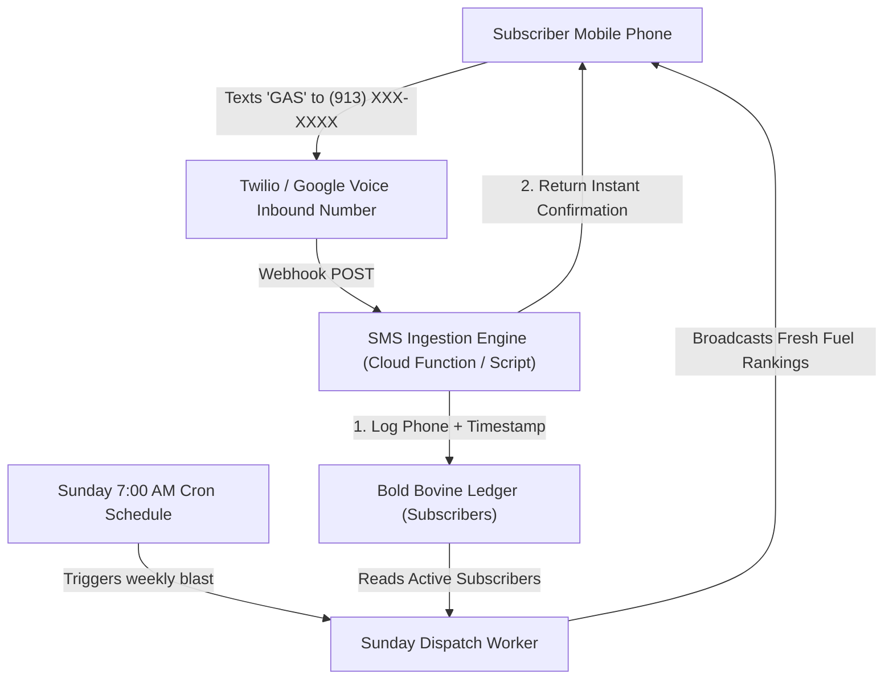

# The Pleasant Ridge Gazette — Architectural & Operational Specification
**Publication**: *The Pleasant Ridge Gazette*  
**Tagline**: *"What things cost and who's good in the 449."*  
**Territory**: USD 449 &bull; Easton &bull; Fort Leavenworth &bull; Leavenworth &bull; Lansing, Kansas  
**Authoritative Location**: `G:\My Drive\pleasant-ridge-gazette\`  
**Date Created**: October 15, 2026  

---

## 1. Editorial & Operational Covenant
1. **Free Forever**: 100% free community price intelligence for residents of USD 449 and the Leavenworth County corridor.
2. **Church & State Separation**: Recommendations, rankings, and ground-truth price data are **never for sale**.
3. **Ground-Truth First**: All data is verified against real-world retail pumps and active road routes.
4. **Zero-Friction Tactical Execution**: Publication production must be automated so weekly maintenance takes under 60 seconds.

---

## 2. Active Core Engine (Phase 1: Corridor Fuel Tracker)
* **The Problem Solved**: Eliminates fuel price guesswork across the 14-station corridor stretching from Easton to Lansing and Fort Leavenworth.
* **Data Ingestion**: Direct, zero-cost GraphQL ingestion from GasBuddy endpoints (`update_gas_feed.py`), outputting structured JSON (`gas_prices.json`) and CSV (`gas_prices.csv`).
* **Covered Stations (14 Total)**:
  1. Sunoco (501 Limit St, Leavenworth)
  2. Murphy USA (Walmart 10th Ave / Eisenhower Rd, Leavenworth)
  3. AAFES Express (Main Post, Fort Leavenworth)
  4. QuikTrip (1205 N Main St, Lansing)
  5. Dillons Fuel Center (Eisenhower Rd, Leavenworth)
  6. 7-Eleven (Metropolitan Ave, Leavenworth)
  7. Casey's General Store (2100 S 4th St, Leavenworth)
  8. Casey's (2004 Spruce St, Leavenworth)
  9. BP / Amoco (601 S Main St, Lansing)
  10. Cenex (109 4H Rd, Lansing)
  11. Fav Trip (1300 S 4th St, Leavenworth)
  12. Hilltop Market / 66 (Easton-Tongie Loop, Easton)
  13. Sam's Club Fuel (Parallel Pkwy Corridor)
  14. Shell (Spruce St, Leavenworth)
* **Outputs**:
  - Live Mobile-Responsive Web Edition
  - 1-Click Printable 8.5" x 11" Paper Flyer (`window.print()`)
  - 1-Click Formatted Text Blast for Community Facebook Groups & SMS

---

## 3. Deferred Capability Specification: The Sunday SMS Dispatch
*(Parked for Phase 2 Deployment per User Directive)*

### 3.1 Objective
Allow USD 449 residents to receive the fresh fuel rankings automatically texted to their mobile phones every Sunday at 7:00 AM CST without requiring app downloads or logins.

### 3.2 Technical Architecture

### 3.3 Infrastructure Requirements
1. **Inbound Phone Number**: Dedicated Kansas `(913)` local VoIP number (via Twilio, Telnyx, or dedicated Google Voice line).
2. **Subscription Ledger**: Google Sheet acting as the authoritative subscriber store:
   - `Phone_Number` (E.164 formatted)
   - `Opt_In_Timestamp`
   - `Status` (`ACTIVE` / `STOP`)
   - `Zip_Code` / `Area` (Optional)
3. **Automated Response Script**:
   - **Trigger**: Inbound keyword `GAS`.
   - **Instant Reply**: *"You're in! This week's 449 gas champ: Sunoco at $3.81/gal. We'll text you the fresh sheet every Sunday at 7 AM. Reply STOP to cancel."*
   - **Compliance**: Respect `STOP`, `UNSUBSCRIBE`, and `HELP` standards automatically.
4. **On-Site Capture Alternative**:
   - Web input field: `[ Enter your mobile number ] -> [ Get Sunday Fuel Sheet ]`
   - Bypasses manual SMS typing and feeds directly into the subscriber ledger.

---

## 4. Future Aperture Expansion Roadmap
1. **Phase 2: Vetted Local Trades & Services**:
   - Vetted directory starting with local tree services (`targets.txt`), mobile small engine repair, excavators, and rural gravel hauling.
   - Transparent verification standards: verified rate ranges, equipment capability, storm response history.
2. **Phase 3: Rural Staples Index**:
   - Tracking local farm-gate egg prices, square bales of brome/alfalfa hay, and bulk animal feed across rural Leavenworth County.
3. **Phase 4: Labeled Community Sponsorships**:
   - Single, prominent weekly sponsor slot for reputable local small businesses.
